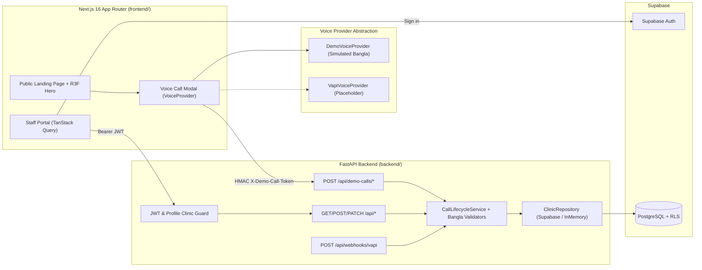
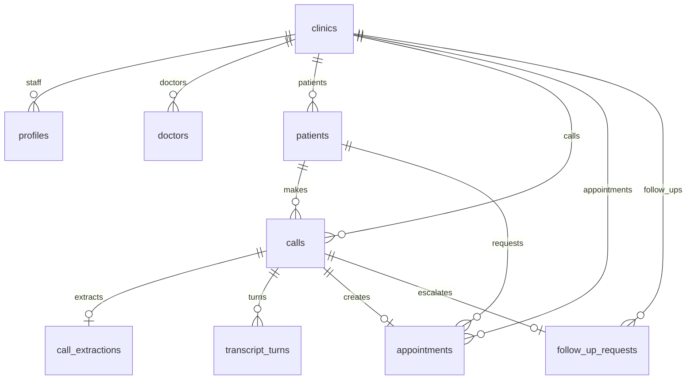

# ByteVoice Bangladesh — Clinical Bangla Voice Receptionist & Staff Portal

> **StrategyByte AI Engineer Practical Assessment Build**  
> **Product:** ByteVoice Bangladesh · **Demo Clinic:** Dhaka Dental Care (`ঢাকা ডেন্টাল কেয়ার`)

ByteVoice Bangladesh is an end-to-end clinical voice receptionist product and staff portal designed for dental clinics, diagnostic centres, and hospital outpatient departments across Bangladesh. It answers patient enquiries in natural Bangla, captures structured appointment requests without fabricating confirmations, validates Bangladeshi mobile numbers, and organises every call, transcript, patient, appointment, and human follow-up in a clinic-isolated staff portal.

---

## 1. Feature Highlights

- **Public Product Website (`/`)**:
  - Art-directed clinical dark navy, off-white, and teal design system with `Hind Siliguri` Bengali typography.
  - **Three.js / React Three Fiber Hero**: Decorative acoustic orb and concentric waveform rings with automatic WebGL capability detection, CSS fallback, `prefers-reduced-motion` compliance, `IntersectionObserver` off-screen pause, and non-blocking pointer events (`pointer-events: none`).
  - **In-App Bangla Receptionist Call Modal**: Triggered from any `"Talk to our Bangla caller"` CTA. Powered by a provider-independent `VoiceProvider` contract with a deterministic simulated Bangla receptionist (`DemoVoiceProvider`) and a documented Vapi adapter placeholder (`VapiVoiceProvider`).
- **Clinical Staff Portal (`/portal/*`)**:
  - **Supabase Auth Sign-In (`/portal/login`)**: Validated with React Hook Form + Zod. No hardcoded passwords or fake login bypasses.
  - **Dashboard (`/portal`)**: Total calls, calls today, completed calls, unconfirmed appointment requests, confirmed appointments, pending follow-ups, 7-day Demo vs Live activity chart, and outcome distribution.
  - **Calls List (`/portal/calls`) & Call Detail (`/portal/calls/[callId]`)**: Search, filters (mode, status, outcome), sortable columns, responsive mobile cards, extracted clinical fields (preserving original spoken Bangla preference alongside parsed `Asia/Dhaka` date/time), sequenced transcript with speaker labels & timestamps, and conditional recording player.
  - **Patients (`/portal/patients` & `/portal/patients/[patientId]`)**: Unicode Bangla name preservation, E.164 phone deduplication, and linked call/appointment history.
  - **Appointments (`/portal/appointments`)**: Strict separation between unconfirmed voice requests (`requested`) and staff-scheduled bookings (`confirmed`). Enforces a scheduled timestamp before confirmation and generates a booking reference (`DDC-XXXXXXXX`).
  - **Follow-up Queue (`/portal/follow-ups`)**: Tracks calls escalated due to unapproved FAQ questions, unverified phone numbers, or ambiguous relative dates/times.
  - **Settings & Integration Status (`/portal/settings`)**: Live backend `/api/health` probe, clinic configuration, Supabase status, and voice provider status.

---

## 2. System Architecture



---

## 3. Database ER Diagram



Full DDL, constraints, indexes, and Row-Level Security (RLS) policies are in [`backend/migrations/001_initial_schema.sql`](backend/migrations/001_initial_schema.sql) and [`docs/database.md`](docs/database.md).

---

## 4. Repository Structure

```text
strategybyte-bangladesh/
  frontend/                        # Next.js 16.4 (App Router, TypeScript strict, Tailwind v4)
    src/
      app/                         # Public landing page (/) and Staff Portal (/portal/*)
      components/
        landing/                   # Navbar, Hero, HowItWorks, Capabilities, UseCases, FinalCtaFooter
        portal/                    # PortalShell, LoginForm, Dashboard, Calls, Patients, Appointments, FollowUps, Settings
        three/                     # HeroScene (R3F) + HeroSceneLoader (WebGL/reduced-motion/off-screen guard)
        ui/                        # Logo, Badges, Card, PageHeader, Skeleton, EmptyState, ErrorBanner
        voice/                     # VoiceCallModal & TalkToBanglaCallerButton
      config/                      # Dhaka Dental Care demo clinic configuration
      dev/fixtures/                # Development-only synthetic fixtures (tree-shaken from production)
      lib/
        api/                       # Typed HTTP client, PortalApi, demoCallsApi
        supabase/                  # Browser Supabase Auth client
        validation/                # Bangla digits, BD phone E.164, spoken date/time parser
      providers/voice/             # VoiceProvider interface, DemoVoiceProvider, VapiVoiceProvider
      types/                       # Shared domain TypeScript contracts
      proxy.ts                     # Next.js 16 server proxy for Supabase session refresh & route guard
    tests/
      frontend.test.mjs            # Automated frontend acceptance & contract checks
    .env.example
    package.json

  backend/                         # Python FastAPI + Pydantic v2 + Supabase + Pytest + Ruff
    app/
      api/routes/portal.py         # REST endpoints (/api/health, /api/calls, /api/demo-calls, /api/webhooks/vapi, ...)
      core/                        # Settings, structured errors, redacting JSON logger, Bangla validators
      dependencies/auth.py         # JWT verification, profile clinic resolution, HMAC demo-call token guard
      integrations/vapi/webhook.py # Vapi webhook verification & idempotent ingestion
      repositories/                # ClinicRepository protocol, InMemoryClinicRepository, SupabaseClinicRepository
      schemas/api.py               # Pydantic v2 request/response schemas
      services/call_service.py     # 11-step call lifecycle orchestration
      main.py                      # FastAPI app factory, CORS, X-Request-Id middleware
    migrations/
      001_initial_schema.sql       # PostgreSQL schema, constraints, indexes, and RLS policies
      seed.sql                     # Idempotent seed for Dhaka Dental Care & sample doctors
    tests/
      test_api_and_validation.py   # 19 Pytest unit & integration tests
    .env.example
    pyproject.toml

  docs/
    architecture.md                # Detailed architecture & data-flow diagrams
    database.md                    # ER diagram & schema design rationale
    voice-integration.md           # 10-step Vapi integration guide & LiveKit/Pipecat extensibility
    assessment-demo.md             # 10-point English interview walkthrough & 3-minute demo script
```

---

## 5. Technology Choices & Trade-offs

1. **Next.js (Frontend) + FastAPI (Backend) without Prisma**:
   - FastAPI owns all database operations, Bangla validation, and webhook ingestion. Adding Prisma in Next.js would introduce a second ORM in a second language over the same Supabase database. Instead, SQL migrations in `backend/migrations/` define the schema once, and the browser never makes privileged database requests.
2. **Provider-Independent `VoiceProvider` Interface**:
   - Decouples the landing page, call modal, and portal from any single voice vendor. `DemoVoiceProvider` works offline with zero credentials today; `VapiVoiceProvider` (or a future `LiveKit` / `Pipecat` adapter) plugs into the exact same event stream and backend persistence lifecycle.
3. **Why GSAP Is Omitted**:
   - CSS keyframe tokens in `globals.css` and `useFrame` in React Three Fiber cover all required UI transitions and 3D motion without adding an extra animation bundle.

---

## 6. Local Setup & Running the Project

### Prerequisites
- **Node.js** `>= 20` and `npm`
- **Python** `>= 3.11` (and `uv` or `pip`)

### Step 1: Start the FastAPI Backend
```bash
cd backend
cp .env.example .env
uv venv --python 3.12
uv pip install -e ".[dev]"
.venv/Scripts/uvicorn app.main:app --reload --port 8000
```
- By default in local development (`STORAGE_BACKEND=memory`), the backend boots with an in-memory repository pre-seeded with **Dhaka Dental Care** so you can test the simulated call persistence immediately before connecting Supabase.
- OpenAPI documentation is served at `http://localhost:8000/docs`.

### Step 2: Start the Next.js Frontend
```bash
cd frontend
cp .env.example .env.local
npm install
npm run dev
```
- Open `http://localhost:3000` for the public landing page and Bangla caller modal.
- For local portal preview before creating a Supabase project, set `NEXT_PUBLIC_DATA_SOURCE=fixtures` in `frontend/.env.local` (development only; automatically disabled in production builds).

### Step 3: Configure Supabase & Reviewer Account (For Live Database + Auth)
1. Create a Supabase project and run [`backend/migrations/001_initial_schema.sql`](backend/migrations/001_initial_schema.sql) followed by [`backend/migrations/seed.sql`](backend/migrations/seed.sql) in the Supabase SQL Editor.
2. In **Supabase Dashboard → Authentication → Users**, create a staff reviewer user (email + password).
3. Link that user to **Dhaka Dental Care** by running the profile insert snippet at the bottom of `backend/migrations/seed.sql`:
   ```sql
   insert into public.profiles (id, clinic_id, full_name, role)
   select id, '11111111-1111-4111-8111-111111111111', 'Clinic Reviewer', 'admin'
   from auth.users
   where email = 'your-reviewer-email@example.com'
   on conflict (id) do update set clinic_id = excluded.clinic_id, role = excluded.role;
   ```
4. Set `SUPABASE_URL`, `SUPABASE_PUBLISHABLE_KEY`, `SUPABASE_SERVICE_ROLE_KEY`, `SUPABASE_JWT_SECRET`, and `STORAGE_BACKEND=supabase` in `backend/.env`, and set `NEXT_PUBLIC_SUPABASE_URL`, `NEXT_PUBLIC_SUPABASE_PUBLISHABLE_KEY`, and `NEXT_PUBLIC_DATA_SOURCE=api` in `frontend/.env.local`.

---

## 7. API Endpoints Summary

| Method | Path | Auth | Description |
|---|---|---|---|
| `GET` | `/api/health` | Public | Health check & database status |
| `GET` | `/api/me` | Bearer JWT | Authenticated staff profile & clinic metadata |
| `GET` | `/api/dashboard/summary` | Bearer JWT | Clinic KPIs, 7-day Demo vs Live counts, outcome distribution |
| `GET` | `/api/calls` | Bearer JWT | Paginated, filterable, sortable clinic call log |
| `GET` | `/api/calls/{call_id}` | Bearer JWT | Full call detail, extraction fields, sequenced transcript |
| `POST` | `/api/calls` | Bearer JWT | Initiate a clinic call record |
| `GET` | `/api/patients` | Bearer JWT | Paginated, searchable clinic patient list |
| `GET` | `/api/patients/{patient_id}` | Bearer JWT | Patient profile with linked calls and appointments |
| `GET` | `/api/appointments` | Bearer JWT | List appointment requests & confirmed bookings |
| `POST` | `/api/appointments` | Bearer JWT | Create an appointment record |
| `PATCH` | `/api/appointments/{id}` | Bearer JWT | Confirm (requires `scheduledStart`), complete, or cancel |
| `GET` | `/api/follow-ups` | Bearer JWT | List human follow-up requests |
| `PATCH` | `/api/follow-ups/{id}` | Bearer JWT | Assign follow-up or update status |
| `POST` | `/api/demo-calls` | Public | Start a simulated demo call for Dhaka Dental Care |
| `POST` | `/api/demo-calls/{id}/turns` | `X-Demo-Call-Token` | Idempotently append transcript turns |
| `POST` | `/api/demo-calls/{id}/finish` | `X-Demo-Call-Token` | Validate Bangla fields & persist completed demo call |
| `POST` | `/api/webhooks/vapi` | `X-Vapi-Secret` | Idempotent Vapi end-of-call webhook ingestion |

---

## 8. Verification & Actual Test Results

### Frontend Verification
```bash
cd frontend
npx next typegen && npx tsc --noEmit   # 0 errors
npm run lint                           # 0 errors, 0 warnings
npm test                               # 5/5 acceptance checks passed
npm run build                          # 13/13 routes compiled & prerendered cleanly
```

### Backend Verification
```bash
cd backend
.venv/Scripts/ruff check .             # All checks passed!
.venv/Scripts/pytest -v                # 19 passed in 1.05s
```
Covered test scenarios in [`backend/tests/test_api_and_validation.py`](backend/tests/test_api_and_validation.py):
- Health check (`200 OK`)
- Unauthenticated portal access rejection (`401`)
- Bangla & ASCII phone validation (`০১৭১২৩৪৫৬৭৮` → `+8801712345678`) and rejection of malformed numbers without guessing
- Bangla Unicode name preservation (`ডা. ফারজানা হক`, `রহিম উদ্দিন`)
- Spoken date/time parsing (`আগামীকাল বিকাল ৫টায়` → `17:00`) and ambiguity detection (`কাল ৫টা` → `ambiguous_time`, `preferred_datetime = None`)
- End-to-end demo call lifecycle, turn sequencing, idempotency on duplicate `providerCallId` and `sequenceNumber`, and automatic follow-up creation on ambiguous time
- Cross-clinic isolation (`staff-other-clinic` cannot see Dhaka Dental Care calls)
- Appointment confirmation safeguard (`422` if `scheduledStart` is missing; generates `DDC-*` booking reference when provided)

---

## 9. Deployment Instructions

- **Frontend (Vercel)**:
  - Set Root Directory to `frontend`.
  - Configure environment variables: `NEXT_PUBLIC_API_BASE_URL`, `NEXT_PUBLIC_SUPABASE_URL`, `NEXT_PUBLIC_SUPABASE_PUBLISHABLE_KEY`, `NEXT_PUBLIC_DATA_SOURCE=api`.
- **Backend (Render)**:
  - Set Root Directory to `backend`.
  - Build command: `pip install .`
  - Start command: `uvicorn app.main:app --host 0.0.0.0 --port $PORT`
  - Configure environment variables from `backend/.env.example` (`STORAGE_BACKEND=supabase`, `SUPABASE_URL`, `SUPABASE_SERVICE_ROLE_KEY`, `SUPABASE_JWT_SECRET`, `CORS_ORIGINS`, `DEMO_CALL_TOKEN_SECRET`).

---

## 10. Documentation Index

- [Architecture & Data Flow (`docs/architecture.md`)](docs/architecture.md)
- [Database Design & ER Diagram (`docs/database.md`)](docs/database.md)
- [Vapi Voice Integration Guide (`docs/voice-integration.md`)](docs/voice-integration.md)
- [English Technical Walkthrough & 3-Minute Demo Script (`docs/assessment-demo.md`)](docs/assessment-demo.md)
