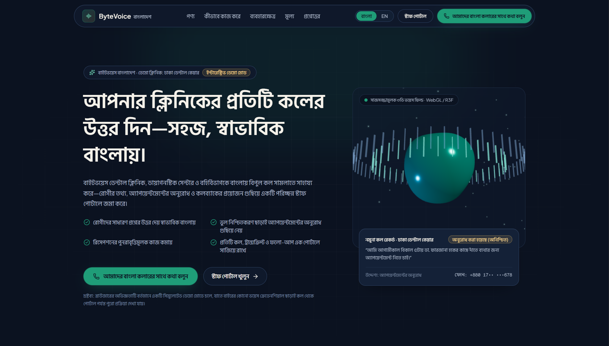

# ByteVoice Bangladesh 🇧🇩🤖

> **An enterprise-grade, AI-powered voice receptionist system tailored for healthcare facilities in Bangladesh, designed to handle patient inquiries, appointments, and follow-ups through natural Bangla and English conversations.**

---

## 📌 1. Project Overview

Traditional healthcare reception desks in Bangladesh face overwhelming challenges, including high call volumes, missed inquiries during peak hours, and tedious manual appointment tracking. **ByteVoice Bangladesh** bridges this gap by deploying a state-of-the-art voice AI agent to automate patient communication, securely capture patient details, and organize transcripts for administrative staff.

---

## ⚠️ 2. Problem Statement

* **Repetitive Patient Inquiries:** Staff spend countless hours answering repetitive questions regarding doctors' schedules, locations, and fees.
* **Missed Calls & Inquiries:** High call volumes often lead to unanswered phone calls, resulting in frustrated patients.
* **Manual Bottlenecks:** Manual appointment booking and record-keeping are error-prone and time-consuming.
* **Language Barriers:** Most automated phone systems fail to handle natural regional Bangla or code-switched Bangla-English effectively.

---

## 🎯 3. Objectives

* **Automate Communication:** Provide seamless, 24/7 patient communication using natural Bangla voice AI.
* **Streamline Operations:** Simplify appointment requests and automate patient information collection.
* **Reduce Staff Workload:** Minimize repetitive administrative tasks so healthcare workers can focus on direct patient care.
* **Maintain Organized Records:** Keep detailed call logs, conversation transcripts, and structured patient queues.

---

## ✨ 4. Key Features

* **Bangla Voice Receptionist:** Handles inquiries and conversations naturally in regional Bangla and code-switched Bangla-English.
* **Smart Appointment Management:** Automatically captures patient demographics, preferred visit times, and department choices.
* **Call & Record Management:** Logs complete conversation transcripts and call histories securely.
* **Staff Follow-up Queue:** Tracks unresolved inquiries and flags urgent patient requests requiring human attention.

---

## 🛠️ 5. Technology Stack

* **Frontend:** Next.js, TypeScript, Tailwind CSS, Three.js / React Three Fiber
* **Backend:** Python, FastAPI, Pydantic
* **Database & Auth:** Supabase PostgreSQL, Supabase Auth
* **AI & Voice Integration:** OpenAI API, Anthropic API, Vapi Voice Platform
* **Workflow Automation:** n8n Orchestration Engine & pdfplumber Processing

---

## 📸 6. Application UI Screenshot
| Frontend Dashboard Preview |
| :---: |
|  |
---


## 🚀 7. Project Setup & Execution

### Step 1: Clone Repository
```bash
git clone https://github.com/moonirul/strategybyte-bangladesh-voice-ai-agent.git
cd strategybyte-bangladesh-voice-ai-agent
```

### Step 2: Setup the Backend
```bash
cd backend
pip install -e ".[dev]"
uvicorn app.main:app --reload --port 8000
```

### Step 3: Setup the Frontend
```bash
cd frontend
npm install
npm run dev
```

---

## 🌐 8. Application Access & Live Links

### **Local Environment**
* **Frontend:** `http://localhost:3000`
* **Backend Docs:** `http://localhost:8000/docs`

### **Live Environment**
* **Live Frontend:** `https://showers-gravity-orientation-dancing.trycloudflare.com/`
* **Live Backend API Docs:** https://threats-mechanics-contractor-facilities.trycloudflare.com/docs

---

## ⚠️ 9. Current Limitations

* **Voice Recognition Accuracy:** Recognition precision may slightly vary depending on regional dialects and background noise.
* **Complex Clinical Queries:** Highly complex or emergency medical inquiries still require immediate human intervention.
* **Dependency on Data:** AI response quality depends heavily on the accuracy of the provided clinic database.

---

## 🔮 10. Future Scope

* **Advanced Voice Models:** Enhance regional Bangla speech comprehension and low-latency responses.
* **Automated Direct Booking:** Integrate directly with hospital management software (HMS) for real-time slot locking.
* **Multi-Clinic Scalability:** Expand support to onboard multiple hospitals and diagnostic centers across Bangladesh.

---

## 📄 11. Contact & Repository

Developed by **Md. Monirul Islam**  
🔗 [ByteVoice Bangladesh Repository](https://github.com/moonirul/strategybyte-bangladesh-voice-ai-agent)