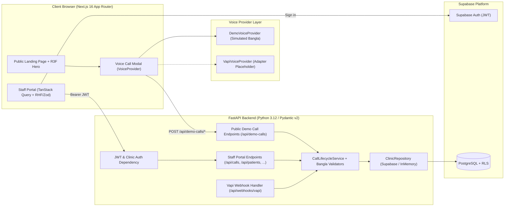
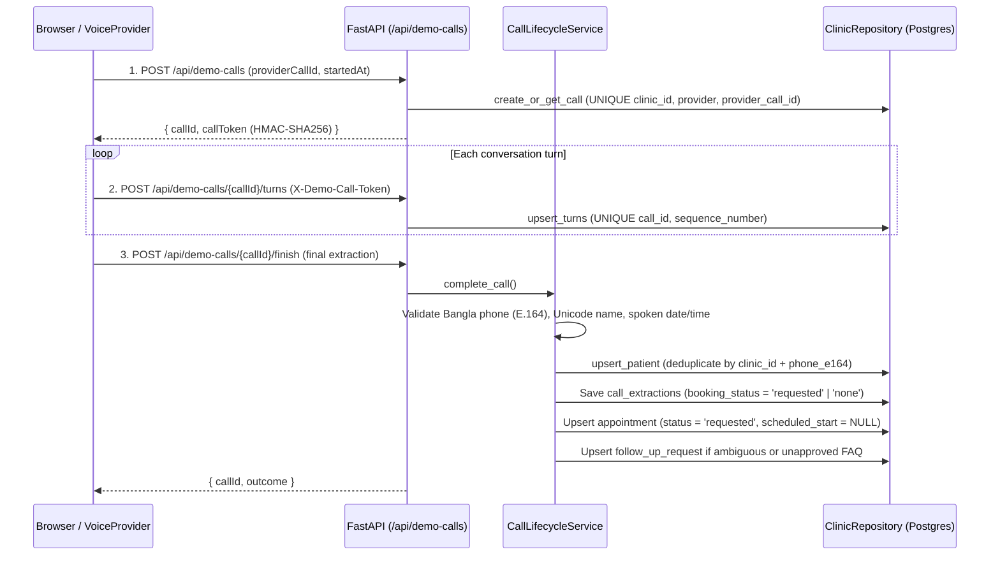

# Architecture Overview — ByteVoice Bangladesh

## 1. System Context & Separation of Responsibilities

ByteVoice Bangladesh is structured as a two-service monorepo (`frontend/` and `backend/`) backed by Supabase PostgreSQL and Supabase Auth:

### Why Next.js + FastAPI (and No Prisma)?
- **Next.js 16 (App Router)** handles public SEO/landing rendering, React Three Fiber 3D visualisation, and interactive Staff Portal workflows. Server Components render static shells while Client Components isolate WebGL, voice state, and portal interactivity.
- **FastAPI (Python)** owns all business logic, Bangla data validation (`validate_bd_phone`, `parse_spoken_preference`), call-lifecycle orchestration, and webhook ingestion. Python is the natural runtime for StrategyByte's AI/voice ecosystem (`Pipecat`, `LiveKit` agents, LLM extraction pipelines).
- **Why Prisma is intentionally omitted**: Adding Prisma inside Next.js alongside FastAPI would split data-access logic across two languages and two ORMs. Instead, SQL migrations in `backend/migrations/001_initial_schema.sql` define the single source of truth for the schema, and the FastAPI repository layer owns all privileged database operations. The browser never makes direct privileged database calls.

---

## 2. Clinic-Level Authorisation & Multi-Tenancy

1. **Authentication**: Staff sign in via Supabase Auth (`signInWithPassword`). The browser holds only the public Supabase URL and publishable/anon key.
2. **Server-Side Clinic Resolution**: Every protected FastAPI endpoint depends on `get_current_profile` (`backend/app/dependencies/auth.py`), which verifies the Bearer JWT and looks up the caller's `ProfileRecord` (`clinic_id`, `role`).
3. **Never Trust Client Clinic IDs**: No API request accepts a `clinic_id` query or body parameter as proof of access. Every repository call (`list_calls(clinic_id)`, `get_call(clinic_id, call_id)`, etc.) filters by the server-resolved `profile.clinic_id`.
4. **Defense-in-Depth with RLS**: `001_initial_schema.sql` enables PostgreSQL Row-Level Security on all 9 tables using `public.current_user_clinic_id()`.

---

## 3. Call Lifecycle & Idempotency

Both simulated demo calls and future live Vapi calls pass through `CallLifecycleService`:

### Failure Recovery & Idempotency Guarantees
- **Duplicate `provider_call_id`**: `UNIQUE (clinic_id, provider, provider_call_id)` returns the existing call record instead of creating duplicates.
- **Duplicate or retried transcript turns**: `UNIQUE (call_id, sequence_number)` makes turn ingestion idempotent.
- **Unconfirmed vs Confirmed Bookings**: AI/voice calls can only ever set `booking_status = 'requested'`. Both the service layer and the PostgreSQL `CHECK (status <> 'confirmed' OR scheduled_start IS NOT NULL)` constraint prevent an appointment from being marked `confirmed` until clinic staff assign a verified `scheduled_start` slot.
