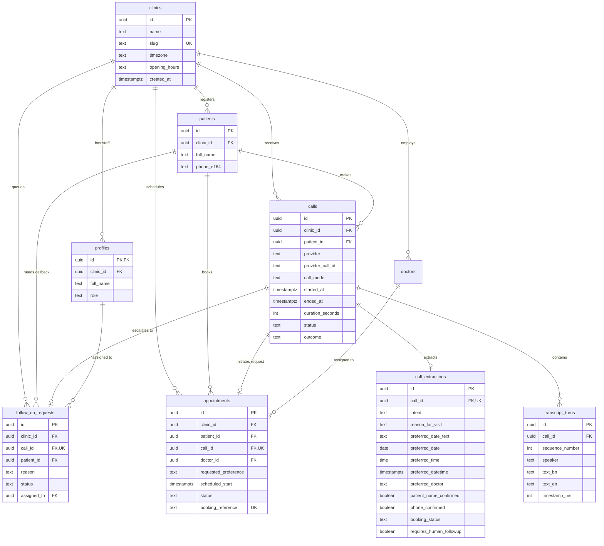

# Database Design & ER Diagram — ByteVoice Bangladesh

## 1. Entity-Relationship Diagram

## 2. Schema Refinements & Rationale

All 9 recommended tables from the specification are implemented in [`backend/migrations/001_initial_schema.sql`](../backend/migrations/001_initial_schema.sql) with two deliberate refinements:

1. **`call_extractions.preferred_date_text` & `appointments.requested_preference`**:
   - Callers often express preferences in natural Bangla phrases such as `"আগামীকাল বিকাল ৫টায়"` or ambiguous phrases like `"কাল ৫টা"`.
   - Storing `preferred_date_text` alongside `preferred_date`, `preferred_time`, and `preferred_datetime` ensures we never lose what the patient actually said—even when our conservative parser refuses to guess an ambiguous time.
2. **Partial Unique Index on Verified Patient Phone Numbers**:
   - `CREATE UNIQUE INDEX uq_patients_clinic_phone ON public.patients(clinic_id, phone_e164) WHERE phone_e164 IS NOT NULL;`
   - Prevents duplicate patient records within a clinic when a valid E.164 Bangladeshi mobile number is captured, while allowing multiple unverified/incomplete caller records where `phone_e164` is `NULL`.
3. **Database-Enforced Booking Integrity**:
   - `CONSTRAINT chk_confirmed_requires_schedule CHECK (status <> 'confirmed' OR scheduled_start IS NOT NULL)` on `appointments` makes it impossible to mark an appointment as `confirmed` without an explicit scheduled timestamp.
