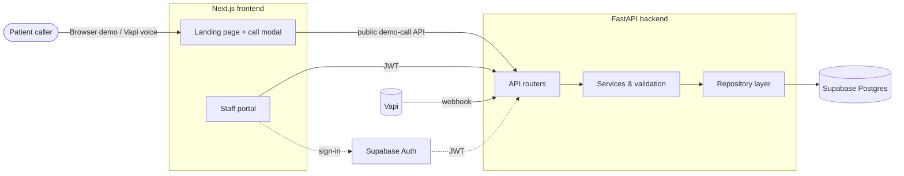

<div align="center">

# ByteVoice Bangladesh

**A Bangla-first AI voice receptionist for clinics, diagnostic centres and hospital outpatient departments.**

Answers patient calls in natural Bangla, captures appointment requests, and organises every call, transcript and follow-up in a secure staff portal.


[Overview](#overview) · [Features](#features) · [Architecture](#architecture) · [Getting started](#getting-started) · [Testing](#testing) · [Security](#security-and-privacy) · [Roadmap](#roadmap)

</div>

---

## Overview

Reception desks in Bangladeshi healthcare facilities handle heavy call volumes in Bangla and mixed Bangla-English. Calls are missed at peak hours, the same questions are answered all day, and appointment details are written down by hand.

**ByteVoice Bangladesh** automates the first conversation. A voice agent talks to the caller in natural Bangla, collects the details a clinic needs, and hands reception staff a clean, structured record to review. The assistant never confirms an appointment on its own; staff stay in control of the schedule.

> **Project status:** assessment-grade demo. The browser experience runs a deterministic **simulated Bangla call** so the complete call-to-portal workflow can be reviewed without voice credentials. A live voice adapter (Vapi) is implemented behind a provider interface and is ready for credentials. See [Current limitations](#current-limitations).

## The problem

| Pain point | Impact |
| --- | --- |
| Repetitive enquiries (hours, location, doctor availability) | Staff time spent on questions with fixed answers |
| Unanswered calls at peak hours | Lost appointments and frustrated patients |
| Manual appointment notes | Errors in names, phone numbers and times |
| IVR systems that do not understand Bangla | Callers abandon automated menus |

## Features

| Capability | Status |
| --- | --- |
| Natural Bangla and Bangla-English conversation flow | Available in simulated demo |
| Appointment **requests** (reason, preferred day/time, preferred doctor), recorded as unconfirmed until staff confirm | Available |
| Bangladeshi mobile number validation (Bangla or ASCII digits) normalised to E.164; uncertain numbers flagged for review | Available |
| Approved clinic FAQ answers (opening hours, location) with no improvised medical advice | Available |
| Human follow-up queue for unapproved questions, ambiguous times and dropped calls | Available |
| Call history with sequenced, timestamped transcripts and extracted fields | Available |
| Role-based staff portal (admin, staff, viewer) with clinic-level isolation | Available |
| Bangla / English interface toggle, ৳ (BDT) formatting, Asia/Dhaka timezone | Available |
| Live telephony through Vapi | Adapter implemented, needs credentials |
| Outbound reminders, SMS and HMS integration | Planned |

### Design principles

- **Humans confirm bookings.** A voice call can only create a *requested* appointment. Staff assign a verified slot before it becomes *confirmed*, and a booking reference is generated at that moment.
- **No guessing.** Missing or ambiguous phone digits and dates are flagged for staff, never invented.
- **Approved information only.** The assistant answers from configured clinic facts and escalates everything else.
- **Clinic isolation by design.** The backend resolves the clinic from the authenticated user's profile and never trusts a client-supplied clinic ID.

## Architecture



**Key decisions**

- **Voice provider abstraction.** The call UI talks only to a typed `VoiceProvider` interface. A simulated Bangla provider works out of the box; the Vapi adapter plugs into the same interface.
- **Repository layer.** Storage is switchable (`supabase` or in-memory), which keeps automated tests fast and independent of the cloud.
- **Server-side authorisation.** The API verifies the Supabase JWT and resolves the clinic and role from the `profiles` table.

More detail lives in [`docs/`](docs/): `architecture.md`, `database.md`, `voice-integration.md` and `assessment-demo.md`.

## Tech stack

| Layer | Technology |
| --- | --- |
| Frontend | Next.js 16 (App Router), React 19, TypeScript, Tailwind CSS v4 |
| Data and forms | TanStack React Query, React Hook Form, Zod |
| 3D visuals | Three.js, React Three Fiber, drei |
| Backend | Python 3.11+, FastAPI, Pydantic v2, httpx |
| Database and auth | Supabase (PostgreSQL, Auth, Row Level Security) |
| Voice | Vapi (adapter) and a built-in simulated Bangla provider |
| Quality | pytest, Ruff, ESLint, Node test runner |

## Project structure

```text
.
├── backend/
│   ├── app/
│   │   ├── api/            # Routers (calls, patients, appointments, follow-ups, webhooks)
│   │   ├── core/           # Settings, logging, security helpers
│   │   ├── dependencies/   # Auth and request dependencies
│   │   ├── integrations/   # Voice provider integrations
│   │   ├── repositories/   # Storage layer (Supabase / in-memory)
│   │   ├── schemas/        # Pydantic request and response models
│   │   └── services/       # Business logic and validation
│   ├── migrations/         # SQL schema and seed data
│   └── tests/
├── frontend/
│   ├── src/
│   │   ├── app/            # Routes: landing page and /portal
│   │   ├── components/     # landing, portal, ui, voice, three
│   │   ├── config/         # Demo clinic and demo pricing
│   │   ├── i18n/           # Bangla / English dictionaries and provider
│   │   ├── lib/            # API client, formatting, Supabase helpers
│   │   └── providers/voice # Voice provider abstraction
│   └── tests/
└── docs/
```

## Getting started

### Prerequisites

- Node.js 20+ and npm
- Python 3.11+
- *(Optional)* a Supabase project and Vapi account for the live setup

### 1. Clone

```bash
git clone https://github.com/moonirul/strategybyte-bangladesh.git
cd strategybyte-bangladesh
```

### 2. Backend

```bash
cd backend
python -m venv .venv && source .venv/bin/activate   # Windows: .venv\Scripts\activate
pip install -e ".[dev]"
cp .env.example .env
uvicorn app.main:app --reload --port 8000
```

With `SUPABASE_URL` unset in development, the backend automatically uses its in-memory store, so you can run it with no cloud setup.

### 3. Frontend

```bash
cd frontend
npm install
cp .env.example .env.local
npm run dev
```

| Service | URL |
| --- | --- |
| Frontend | <http://localhost:3000> |
| API docs (Swagger) | <http://localhost:8000/docs> |

### Quick preview without Supabase

For local UI review you can run the staff portal on synthetic data. Set this in `frontend/.env.local`:

```bash
NEXT_PUBLIC_DATA_SOURCE=fixtures
```

Fixture mode bypasses sign-in and is **automatically disabled in production builds**.

### Environment variables

**Backend** (`backend/.env`)

| Variable | Purpose |
| --- | --- |
| `APP_ENV`, `APP_VERSION` | Runtime environment and version label |
| `CORS_ORIGINS` | Comma-separated allowed frontend origins |
| `DEMO_CLINIC_SLUG` | Clinic used for public simulated calls |
| `STORAGE_BACKEND` | `supabase` or `memory` |
| `SUPABASE_URL`, `SUPABASE_PUBLISHABLE_KEY` | Supabase connection |
| `SUPABASE_SERVICE_ROLE_KEY`, `SUPABASE_JWT_SECRET` | **Server only.** Never expose to the browser |
| `DEMO_CALL_TOKEN_SECRET` | Signs per-call tokens for public demo-call endpoints |
| `VAPI_WEBHOOK_SECRET` | Optional shared secret for `POST /api/webhooks/vapi` |

**Frontend** (`frontend/.env.local`)

| Variable | Purpose |
| --- | --- |
| `NEXT_PUBLIC_API_BASE_URL` | FastAPI base URL, no trailing slash |
| `NEXT_PUBLIC_SUPABASE_URL`, `NEXT_PUBLIC_SUPABASE_PUBLISHABLE_KEY` | Staff sign-in |
| `NEXT_PUBLIC_DATA_SOURCE` | `fixtures` for development-only synthetic data |
| `NEXT_PUBLIC_CONTACT_EMAIL` | Contact address shown on the landing page |
| `NEXT_PUBLIC_VAPI_PUBLIC_KEY`, `NEXT_PUBLIC_VAPI_ASSISTANT_ID` | Enable the live Vapi adapter |

> Only `NEXT_PUBLIC_*` values reach the browser. Keep every secret key in the backend.

### Staff access

No password is stored in this repository. Create a reviewer account in Supabase Auth and link it to a clinic profile using `backend/migrations/seed.sql`.

## Bangla / English and Bangladesh localisation

- A global **বাংলা | EN** switch covers the landing page, sign-in and the whole staff portal. Bangla is the default, and the choice is remembered in the browser.
- Dates use the **Asia/Dhaka** timezone. Amounts use ৳ with lakh grouping (for example ৳1,25,000, or ৳১,২৫,০০০ in Bangla mode).
- Phone input follows Bangladeshi mobile formats.
- Translations live in `frontend/src/i18n/dictionaries/`. Both languages must define the same keys, and the TypeScript build fails if they drift apart.

### Demo pricing

The landing page includes an **illustrative** pricing section in BDT. It is labelled *Demo Pricing*, states that the prices are not actual service charges, reads from a standalone config file (`frontend/src/config/demo-pricing.ts`), and has no payment or backend connection.

## Testing

```bash
# Backend
cd backend
pytest
ruff check .

# Frontend
cd frontend
npm test          # acceptance and contract checks
npm run lint
npx tsc --noEmit
npm run build
```

## Security and privacy

- Staff authentication through Supabase Auth, verified server-side by JWT.
- Role-based access (admin, staff, viewer) with the clinic resolved on the server.
- Row Level Security on the database tables.
- Phone numbers are masked in list views unless the viewer's role permits full numbers, and masked in logs.
- Optional shared-secret verification for incoming Vapi webhooks.
- Per-call signed tokens protect the public demo-call endpoints.
- Voice recordings are not stored in the simulated demo.

> This project is a demonstration build. Review data-protection, consent and call-recording requirements with your legal advisers before handling real patient data.

## Current limitations

- The default experience is a **simulated** call. Live voice requires Vapi credentials and further production hardening.
- Recognition quality in live use will vary with dialect, accent and background noise.
- Emergency and complex clinical queries are escalated to staff and are not handled by the assistant.
- Answer quality depends on the accuracy of the configured clinic information.
- Outbound reminders, SMS and hospital-management-system integration are not implemented.

## Roadmap

- [ ] Live telephony in production with monitored call quality
- [ ] Real-time slot checking and booking through HMS integrations
- [ ] Outbound appointment reminders and SMS follow-ups
- [ ] Multi-clinic onboarding and per-clinic configuration
- [ ] Call analytics and reporting dashboards
- [ ] Improved dialect coverage and lower response latency

## Contributing

Issues and pull requests are welcome. Please run the backend and frontend checks above before opening a pull request, and keep API changes backward compatible.

## License

No license has been specified yet. Until one is added, all rights are reserved by the author.

## Author

Built by **Md. Monirul Islam** · [GitHub repository](https://github.com/moonirul/strategybyte-bangladesh)
